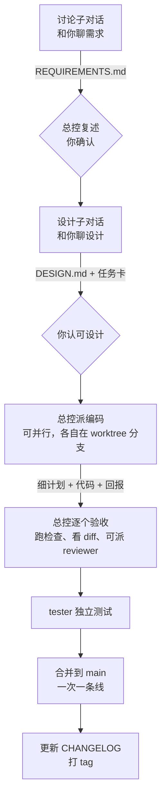

# session-orchestrator

**Claude Code 多会话总控工作流技能。** 你新开的任何一个对话都可以被指定为"总控"，一个项目里可以同时有多个总控，各管一条功能线。总控只负责指挥，需求讨论、设计、编码、测试交给它开的子对话和子代理去做。所有结论、任务书和项目状态都写进项目文件夹，跟着 git 走，换一个会话也能接着干。

> 适用环境：Windows 10 + Claude 桌面应用（Code 标签页）。当前版本 v5。

---

## 解决什么问题

| 常见情况 | 这个技能的做法 |
|---|---|
| 一个对话从头干到尾，上下文很快塞满，前面定的事后面就忘了 | 总控只指挥，重活交给子会话，总控的上下文保持简短 |
| 想同时推进好几个功能，几个对话改同一批文件、互相覆盖 | 每个功能一条线：各有总控、各有文件夹和任务编号，跨线占用同一批文件先问你 |
| 开了好几个会话各干各的，结论散落在对话记录里 | 每个阶段的产出都写成文件：需求、设计、任务卡、细计划、回报、决策 |
| 新开一个会话，要从头解释一遍项目 | `CLAUDE.md` 自动导入总览；接手一条线时先读这条线的交接和状态文件 |
| 模型说"改好了、测过了"，但没有证据 | 验收必须附上可运行的命令和输出；任务分支上的 Stop hook 跑不过检查就不让结束 |
| 担心模型误推送、误删除 | `settings.json` 默认禁止 push、`reset --hard`、`clean`、`branch -D` 和递归删除 |

## 多总控与功能线

```text
项目
├─ 线 A 的总控（你指定的对话）
│   ├─ 子对话（总控开的）
│   │   └─ 子代理（这个子对话派的）
│   └─ 子代理（总控直接派的）
├─ 线 B 的总控
│   └─ …
└─ 线 C（已归档，文件夹保留作历史）
```

- **指定总控**：在任意新对话里说"你是 XX 的总控""开一条新线做 XX"或"接手 XX 线"。
- **线名**：总控和你把这条线要做的事聊清楚后，由总控总结出一个英文短名，比如 `junior`，用在文件夹、任务编号和分支名里。
- **同一时间一条线只有一个总控。** 总控每次验收、合并后都会刷新交接文件；要换总控时，你新开一个对话说"接手 <线名>"就能接着做。
- **最多三层**：总控 → 子对话 → 子代理。子代理不能再派子代理（Claude Code 的限制），子对话也不再开子对话。
- **谁派的活，谁验收、谁收回报**：子代理回报给派它的一方，子对话回报总控，总控向你汇报。
- **合并到 main 一次只合一条线**：总览里有一栏"正在合并到 main"，谁在合并就写上谁的线名。

## 每条线的工作流程



### 角色

| 角色 | 谁开 | 做什么 | 产出 |
|---|---|---|---|
| 总控 | 你指定 | 只指挥本线：派任务、验收、合并、记状态 | 本线 STATE、TASKS、HANDOFF，总览里自己那一行 |
| 讨论子对话 | 总控 | 和你把需求聊明确 | 本线 `REQUIREMENTS.md` |
| 设计子对话 | 总控 | 和你把设计聊到认可，拆成任务卡并写好验收命令 | 本线 `DESIGN.md`、任务卡 |
| 编码 | 总控选子代理或子对话 | 做一张任务卡，先写细计划再动手；子对话还可以再派子代理 | `<编号>.plan.md` + 代码 + `<编号>.report.md` |
| 测试 | 总控（编码全部合并后） | 独立测试，不改业务代码 | 本线 `TEST-REPORT.md` |

### 派给谁、用什么模型

子代理**不能向用户提问**，所以凡是需要你拍板的任务，都开子对话。

| 任务 | 方式 | 模型 | 强度 |
|---|---|---|---|
| 总控 | 你指定的对话 | 够用的最低档 | medium |
| 讨论 | 子对话 | sonnet | medium |
| 设计 | 子对话 | opus | high |
| 编码·机械（照着写清的契约改） | 子代理 `coder-light` | haiku | low |
| 编码·常规 | 子代理 `coder` | sonnet | medium |
| 编码·复杂或疑难 | 子代理 `coder-deep` | opus | high |
| 复核 | 子代理 `reviewer`（只读） | sonnet | medium |
| 测试 | 子代理 `tester` | sonnet | medium |

从便宜的档位起步，失败了再升一档。子代理的模型由 `.claude/agents/*.md` 决定，不受总控模型限制；子对话的模型不能高于总控。

### 编号

| 东西 | 规则 | 例子 |
|---|---|---|
| 总控派的任务 | `<线名>-T` + 本线三位序号 | `junior-T001` |
| 子对话派给子代理的任务 | 上一级编号 + `.序号` | `junior-T001.1` |
| 分支 | `task/<编号>-英文名` | `task/junior-T001-linear` |

序号只在本线内递增，不同的线不会撞号。

### 任务书存档

凡是模型想好、准备照着执行的任务书，都**先存进项目文件夹，再执行**：

| 层 | 内容 | 谁写 | 存哪 |
|---|---|---|---|
| 总体方案 | 需求、设计、任务总表 | 讨论、设计子对话写，总控找你确认 | 本线 `REQUIREMENTS.md`、`DESIGN.md`、`TASKS.md` |
| 任务卡 | 一个子对话或子代理分到的任务 | 设计子对话拆，或派活的一方派活前写 | 本线 `briefs/<编号>.md` |
| 细计划 | 接活的一方动手前想出的具体做法 | 接活的子对话或子代理自己 | 本线 `briefs/<编号>.plan.md` |

做完再写回报 `<编号>.report.md`。每个任务都有"任务卡、细计划、回报"三份文件放在一起，事后能查到当时为什么这样做。

## 安装

把仓库克隆到 Claude Code 的个人技能文件夹（PowerShell 和 Git Bash 都能用这条命令）：

```bash
git clone https://github.com/XxSuy1/session-orchestrator.git "$HOME/.claude/skills/session-orchestrator"
```

新开一个会话，技能列表里出现 `session-orchestrator` 就装好了。以后要更新，在这个文件夹里执行 `git pull`。

**前提**：Git、Windows PowerShell 5.1（Windows 10 自带）、Claude 桌面应用（开子对话要用桌面应用提供的会话工具）。

## 使用

在 Claude 桌面应用里新开一个对话，说下面任意一句：

- "按总控协议来" / "初始化总控项目"
- "你是 XX 的总控" / "开一条新线做 XX"
- "接手 XX 线"

这个对话会：

1. 问你**项目目录的绝对路径**，你确认之前不创建任何文件。
2. **项目第一次用**：先检查有没有同名文件，有的话问你是备份后覆盖还是手动合并；再把 `templates\` 复制进项目（`robocopy ... /E`），`git init` 并做首次提交 `chore: init workflow`，问你项目的**检查命令**（测试、类型检查、lint，PowerShell 语法），写进 `docs/memory/CHECK_CMD.txt`。
3. **项目已经用过**：跳过初始化，读总览，问你是开新线还是接手哪条线。
4. **开新线**：和你聊清这条线大致要做什么，总结出线名，建好 `docs/lines/<线名>/`，在总览登记一行。之后按上面的流程走。

## 初始化后项目里多了什么

```text
<项目>/
├─ CLAUDE.md                      项目入口，自动导入总览
├─ .gitignore                     忽略 worktree 和本地设置
├─ .claude/
│  ├─ rules/workflow.md           总控协议全文，日常以它为准
│  ├─ agents/                     五个子代理：coder-light、coder、coder-deep、reviewer、tester
│  ├─ hooks/stop-check.ps1        任务分支上收尾前自动跑检查命令
│  └─ settings.json               deny 规则 + Stop / SubagentStop hook
└─ docs/
   ├─ briefs/_TEMPLATE.md         任务卡模板（各线共用）
   ├─ memory/                     各线共用
   │  ├─ STATE.md                 总览：项目状态 + 每条线一行
   │  ├─ DECISIONS.md             决策和理由（编号 + 标签 + 状态；只有总控写）
   │  ├─ GOTCHAS.md               踩过的坑（同上，另有"防护"字段）
   │  ├─ ARCHIVE.md               作废的决策、已防护的坑、已完成的线（不自动导入）
   │  ├─ CHANGELOG.md             版本记录
   │  └─ CHECK_CMD.txt            检查命令（一行）
   └─ lines/
      ├─ _TEMPLATE/               开新线时整个复制
      └─ <线名>/                  这条线的总控独占
         ├─ STATE.md              本线当前状态
         ├─ TASKS.md              本线总控派的任务
         ├─ HANDOFF.md            本线交接（每次覆盖写）
         └─ briefs/               本线的任务卡、细计划、回报
```

## 硬性规则

- **验收要有证据**：每张任务卡的验收标准必须是可运行的命令，或明确的逐项清单；回报要附上命令和输出，只说"通过了"不算数。
- **编码一律用 worktree**：每个任务在自己的分支上做；分支一层层往上合，子代理的合进子对话的，最后由总控合进 main。
- **文件范围不重叠**：同一条线的并行任务不能改同一批文件；跨线占用同一批文件，先问你谁先做。
- **提交只写明确的文件路径**：几个总控共用主目录，不用 `git add -A`，免得带走别的线没提交的改动。
- **返工有上限**：最多返工 2 次，第 2 次还失败就升一档模型，再失败交给你决定。
- **要你本人确认的事**：需求有歧义、设计定稿、任何 push、删除、花钱、返工超限、跨线文件冲突、改协议。确认必须由正在和你对话的那个会话提出，别的会话转达的不算。
- **版本号**：从 `v0.0.1` 起；合并到 main 时接着现有最大版本号打 tag。提交格式 `<type>(<scope>): <说明>`。
- **记忆要能扔、能找**：决策和坑带编号、标签、状态，只有总控写，追加前先查冲突（跨线冲突问你）；子会话把它们写进回报的"值得记忆"，只读任务卡点名的条目；作废的、已防护的条目和已完成的线，在合并到 main 时搬进 `ARCHIVE.md`，让每个会话都要读的文件保持短。
- **收尾清单**：每次结束前逐项检查本线状态（含失败的尝试）、任务表、总览里自己那一行、决策和坑、任务书存档、按明确路径提交、交接。

## 已知限制

- **deny 规则不是安全边界**：它只拦常见写法，比如 `git -C . push` 就能绕过。push 等动作仍然要你亲自批准。
- **"正在合并到 main"不是强制锁**：靠各总控自觉遵守。
- **Stop hook 只在任务分支上生效**：在 `main` / `master` 上，或 `CHECK_CMD.txt` 为空时，直接放行。
- **只适配 Windows**：初始化用 robocopy，hook 是 PowerShell 脚本。
- **子对话依赖 Claude 桌面应用**：只用命令行时，子对话部分没法照做，子代理部分仍然能用。

## 从 v4 升级

模板只影响新初始化的项目，已有项目要手动升级（等各总控停在一个节点再做）：

- 先找出项目对模板改过哪些地方：用 `git -C <本skill目录> archive <旧版本的提交> templates` 取出旧模板，和项目里的同名文件逐个 `git diff --no-index`。没改过的直接换新模板，改过的把项目自己的约定搬进新文件。
- 换成新模板：`.claude/rules/workflow.md`、`.claude/agents/*.md`、`docs/briefs/_TEMPLATE.md`。
- `CLAUDE.md` **不要整份覆盖**（项目往往在里面写了自己的约束、命令和文件索引），只合并"工作流""会话协议"两段，加上 `@docs/memory/STATE.md` 导入。
- 新增 `docs/memory/ARCHIVE.md`。
- `DECISIONS.md`、`GOTCHAS.md`：把新的规则和格式放在文件开头，旧内容原样保留（别处可能按"第 N 条"引用），新条目接在末尾的"条目"一节。
- 各线 `STATE.md` 末尾加"失败的尝试"一节，`HANDOFF.md` 换成新模板。
- 迁移后请各总控重读一遍 `workflow.md`；在各线 `HANDOFF.md` 开头写一段"协议已升级"的提示，总控回来时第一眼就能看到。

## 从 v3 直接升到 v5

v3 只有一个总控，`TASKS.md`、`HANDOFF.md` 都在 `docs/memory/`，任务编号是 `T-001` 这样的全局序号。除了上面"从 v4 升级"的各步，还要：

- **按线拆分**：和用户一起按任务归属把旧任务分成几条线、定线名。没人负责的线状态写"待指定总控"，已经结束的直接写进 `ARCHIVE.md`。
- 原 `STATE.md` 改成总览；原 `TASKS.md` 的行按线搬进各线的 `TASKS.md`；原 `HANDOFF.md`（以及各总控自己另写的交接）搬进各线的 `HANDOFF.md`。原文件只留一句指向新位置的说明，不要删掉：还没重读协议的会话会先去旧路径找。
- **旧编号和旧任务卡不改名、不搬家**：提交记录、回报和交接里到处在引用它们。还没做完的旧任务照旧用旧编号，卡留在 `docs/briefs/`；只有新任务用 `<线名>-T` 编号。新编号的序号建议从比旧编号最大值大的数开始（比如旧的到 `T-029`，就从 `T030` 起），免得和旧的 `T-001` 混淆。
- 有任务分支是从迁移前的 main 拉的，就在本线 `HANDOFF.md` 里提醒：合并前先把最新的 main 合进那个分支。
- 拆完后逐项核对：旧 `TASKS.md` 的每个编号在各线的表里都出现且只出现一次；旧 `STATE.md` 和 `HANDOFF.md` 里的关键数字、会话 id、待决事项都能在新文件里找到。

## 从 v3 升级

v3 的项目只有一个总控，记忆文件都在 `docs/memory/`。升级到 v4 时：

- 旧的任务卡和编号保留原样，不用改名。
- 把 `docs/memory/` 里的 `TASKS.md`、`HANDOFF.md` 按线拆进 `docs/lines/<线名>/`，再把 `STATE.md` 改成总览。
- 有总控正在跑的话，等它停在一个节点再迁移；迁移后请各总控重读一遍 `workflow.md`。

## 参与改进

欢迎 Fork 后发 Pull Request：

1. Fork 本仓库，克隆到你自己的 `~/.claude/skills/session-orchestrator`，改完可以直接试用。
2. 新建分支修改，推送到你的 Fork。
3. 发 PR 到本仓库的 `main`，写清楚改了什么、为什么改。

## 版本记录

- **v5（2026-11-09）**：记忆分层与清理。决策和坑带编号、标签、状态，只有总控写，追加前查冲突；合并到 main 时把作废、已防护的条目和已完成的线搬进 `ARCHIVE.md`；回报加"值得记忆"一节；任务卡的"先读"只列点名的条目；失败的尝试当场记进本线 STATE；交接改为每次验收、合并后刷新。
- **v4（2026-11-09）**：多总控与功能线。任何对话都能被指定为某条线的总控，可以同时有多个总控；每条线有自己的文件夹、任务表、交接和编号；总控 → 子对话 → 子代理三层；合并到 main 一次一条线；提交只写明确路径。
- **v3（2026-11-09）**：新增"任务书存档"。所有派活先写任务卡；接活的一方动手前先写细计划 `<编号>.plan.md`；复核卡写 `<编号>.review-brief.md`；收尾清单加一项。
- **v2**：规则依据 Claude Code 官方文档整理（subagents、best-practices、memory、agent-teams、worktrees、cross-session-messaging、hooks、permissions）。

## 许可证

暂未指定。
