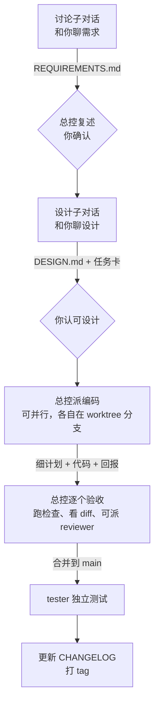

# session-orchestrator

**Claude Code 多会话总控工作流技能。** 主对话当"总控"，只负责指挥；需求讨论、设计、编码、测试交给子对话和子代理去做。所有结论、任务书和项目状态都写进项目文件夹，跟着 git 走，换一个会话也能接着干。

> 适用环境：Windows 10 + Claude 桌面应用（Code 标签页）。当前版本 v3。

---

## 解决什么问题

| 常见情况 | 这个技能的做法 |
|---|---|
| 一个对话从头干到尾，上下文很快塞满，前面定的事后面就忘了 | 主对话只指挥，重活交给子会话，总控的上下文保持简短 |
| 开了好几个会话各干各的，结论散落在对话记录里 | 每个阶段的产出都写成文件：需求、设计、任务卡、细计划、回报、决策 |
| 新开一个会话，要从头解释一遍项目 | `CLAUDE.md` 自动导入 `STATE.md`，新会话开头先读交接和状态文件 |
| 模型说"改好了、测过了"，但没有证据 | 验收必须附上可运行的命令和输出；任务分支上的 Stop hook 跑不过检查就不让结束 |
| 担心模型误推送、误删除 | `settings.json` 默认禁止 push、`reset --hard`、`clean`、`branch -D` 和递归删除 |

## 工作流程



### 角色

| 角色 | 谁开 | 做什么 | 产出 |
|---|---|---|---|
| 总控（主对话） | 你 | 只指挥：派任务、验收、合并、记状态 | `STATE.md`、`TASKS.md`、`DECISIONS.md` |
| 讨论子对话 | 总控 | 和你把需求聊明确 | `REQUIREMENTS.md` |
| 设计子对话 | 总控 | 和你把设计聊到认可，拆成任务卡并写好验收命令 | `DESIGN.md`、`docs/briefs/T-xxx.md` |
| 编码 | 总控选子代理或子对话 | 做一张任务卡，先写细计划再动手 | `T-xxx.plan.md` + 代码 + `T-xxx.report.md` |
| 测试 | 总控（编码全部合并后） | 独立测试，不改业务代码 | `TEST-REPORT.md` |

### 派给谁、用什么模型

子代理**不能向用户提问**，所以凡是需要你拍板的任务，都开子对话。

| 任务 | 方式 | 模型 | 强度 |
|---|---|---|---|
| 总控 | 主对话 | 够用的最低档 | medium |
| 讨论 | 子对话 | sonnet | medium |
| 设计 | 子对话 | opus | high |
| 编码·机械（照着写清的契约改） | 子代理 `coder-light` | haiku | low |
| 编码·常规 | 子代理 `coder` | sonnet | medium |
| 编码·复杂或疑难 | 子代理 `coder-deep` | opus | high |
| 复核 | 子代理 `reviewer`（只读） | sonnet | medium |
| 测试 | 子代理 `tester` | sonnet | medium |

从便宜的档位起步，失败了再升一档。子代理的模型由 `.claude/agents/*.md` 决定，不受总控模型限制；子对话的模型不能高于总控。

### 任务书存档（v3 新增）

凡是模型想好、准备照着执行的任务书，都**先存进项目文件夹，再执行**：

| 层 | 内容 | 谁写 | 存哪 |
|---|---|---|---|
| 总体方案 | 需求、设计、任务总表 | 讨论、设计子对话写，总控找你确认 | `REQUIREMENTS.md`、`DESIGN.md`、`TASKS.md` |
| 任务卡 | 一个子代理或子对话分到的任务 | 设计子对话拆，或总控派活前写 | `docs/briefs/T-xxx.md` |
| 细计划 | 接活的一方动手前想出的具体做法 | 接活的子代理或子对话自己 | `docs/briefs/T-xxx.plan.md` |

做完再写回报 `T-xxx.report.md`。这样每个任务都有"任务卡、细计划、回报"三份文件放在一起，事后能查到当时为什么这样做。

## 安装

把仓库克隆到 Claude Code 的个人技能文件夹（PowerShell 和 Git Bash 都能用这条命令）：

```bash
git clone https://github.com/XxSuy1/session-orchestrator.git "$HOME/.claude/skills/session-orchestrator"
```

新开一个会话，技能列表里出现 `session-orchestrator` 就装好了。以后要更新，在这个文件夹里执行 `git pull`。

**前提**：Git、Windows PowerShell 5.1（Windows 10 自带）、Claude 桌面应用（开子对话要用桌面应用提供的会话工具）。

## 使用

在 Claude 桌面应用里对主对话说下面任意一句：

- "按总控协议来"
- "初始化总控项目"
- "主对话指挥子对话和子代理，做需求→设计→编码→测试"

总控会先做初始化：

1. 问你**项目目录的绝对路径**，你确认之前不创建任何文件。
2. 把 `templates\` 里的全部内容复制到项目根目录（`robocopy ... /E`）。
3. `git init`，再做首次提交 `chore: init workflow`。没有首次提交，worktree 就建不起来。
4. 问你项目的**检查命令**（测试、类型检查、lint，PowerShell 语法），写进 `docs/memory/CHECK_CMD.txt`。
5. 读项目里的 `.claude/rules/workflow.md`，之后都按它执行。

> ⚠️ **已有项目要先备份。** robocopy 会覆盖同名文件，比如 `CLAUDE.md`、`.gitignore`，以及 `docs/memory/` 里的同名记忆文件。已经有这些文件的项目，建议先备份，再手动合并。

## 初始化后项目里多了什么

```text
<项目>/
├─ CLAUDE.md                      项目入口，自动导入 STATE.md
├─ .gitignore                     忽略 worktree 和本地设置
├─ .claude/
│  ├─ rules/workflow.md           总控协议全文，日常以它为准
│  ├─ agents/                     五个子代理：coder-light、coder、coder-deep、reviewer、tester
│  ├─ hooks/stop-check.ps1        任务分支上收尾前自动跑检查命令
│  └─ settings.json               deny 规则 + Stop / SubagentStop hook
└─ docs/
   ├─ briefs/_TEMPLATE.md         任务卡模板
   └─ memory/
      ├─ STATE.md                 当前状态（保持简短）
      ├─ TASKS.md                 任务总表：方式、模型、强度、分支、状态、验收标准
      ├─ DECISIONS.md             决策和理由
      ├─ GOTCHAS.md               踩过的坑
      ├─ HANDOFF.md               交接（每次覆盖写）
      ├─ CHANGELOG.md             版本记录
      └─ CHECK_CMD.txt            检查命令（一行）
```

## 硬性规则

- **验收要有证据**：每张任务卡的验收标准必须是可运行的命令，或明确的逐项清单；回报要附上命令和输出，只说"通过了"不算数。
- **编码一律用 worktree**：每个编码任务在自己的分支 `task/T-xxx-英文名` 上做，并行任务的文件范围不能重叠。
- **返工有上限**：最多返工 2 次，第 2 次还失败就升一档模型，再失败交给你决定。
- **要你本人确认的事**：需求有歧义、设计定稿、任何 push、删除、花钱、返工超限、改协议。确认必须由正在和你对话的那个会话提出，别的会话转达的不算。
- **版本号**：从 `v0.0.1` 起；每个验收合并的里程碑，总控更新 CHANGELOG 并打 tag。提交格式 `<type>(<scope>): <说明>`。
- **收尾清单**：每次结束前逐项检查 STATE、TASKS、DECISIONS、GOTCHAS、任务书存档、未提交的改动、交接。

## 已知限制

- **deny 规则不是安全边界**：它只拦常见写法，比如 `git -C . push` 就能绕过。push 等动作仍然要你亲自批准。
- **Stop hook 只在任务分支上生效**：在 `main` / `master` 上，或 `CHECK_CMD.txt` 为空时，直接放行。
- **只适配 Windows**：初始化用 robocopy，hook 是 PowerShell 脚本。
- **子对话依赖 Claude 桌面应用**：只用命令行时，子对话部分没法照做，子代理部分仍然能用。

## 参与改进

欢迎 Fork 后发 Pull Request：

1. Fork 本仓库，克隆到你自己的 `~/.claude/skills/session-orchestrator`，改完可以直接试用。
2. 新建分支修改，推送到你的 Fork。
3. 发 PR 到本仓库的 `main`，写清楚改了什么、为什么改。

## 版本记录

- **v3（2026-11-09）**：新增"任务书存档"。所有派活先写任务卡；接活的一方动手前先写细计划 `T-xxx.plan.md`；复核卡写 `T-xxx.review-brief.md`；收尾清单加一项。
- **v2**：规则依据 Claude Code 官方文档整理（subagents、best-practices、memory、agent-teams、worktrees、cross-session-messaging、hooks、permissions）。

## 许可证

暂未指定。
